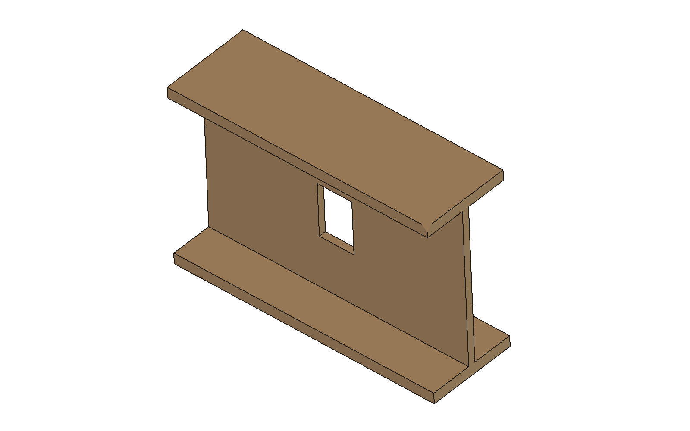
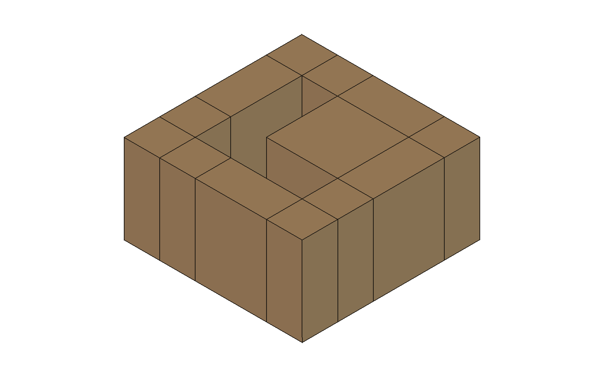

<a id="readme-top"></a>

<div align="center">

<h1 align="center">Огранка (ogranka)</h1>

<p align="center">
  Tekla и IFC в STEP AP214. Плоские грани, общие рёбра, миллиметры. Без OpenCASCADE, xBIM и IfcOpenShell.
  <br />
  <br />
  <a href="https://github.com/Bezooom/ogranka/blob/HEAD/docs/VERIFICATION.md"><strong>Проверка стенда »</strong></a>
  ·
  <a href="https://github.com/Bezooom/ogranka/blob/HEAD/docs/WINDOWS.md">Протокол Windows</a>
  ·
  <a href="https://github.com/Bezooom/ogranka/issues/new?labels=bug">Сообщить об ошибке</a>
</p>

<p align="center">
  <a href="https://github.com/Bezooom/ogranka/blob/HEAD/docs/VERIFICATION.md"></a>
  <a href="https://github.com/Bezooom/ogranka/blob/HEAD/LICENSE"></a>
  <a href="https://github.com/Bezooom/ogranka/commits"></a>
  <a href="https://github.com/Bezooom/ogranka/stargazers"></a>
</p>

</div>

> [!IMPORTANT]
> **Linux-стенд проверен числами. Живого Tekla на стенде не было.** Ниже факты прогона 2026-11-14, не заявка «открывается в SolidWorks». Импорт в CAD и `--live` ещё не принимались. Протокол следующего стенда: [`docs/WINDOWS.md`](docs/WINDOWS.md).

<details open>
<summary><b>Содержание</b></summary>

- [О проекте](#о-проекте)
- [Что уже измерено](#что-уже-измерено)
- [Быстрый старт](#быстрый-старт)
- [Что пишет файл](#что-пишет-файл)
- [Честные ограничения](#честные-ограничения)
- [Дальше: Windows](#дальше-windows)
- [Структура](#структура)
- [Лицензия](#лицензия)

</details>

## О проекте

Имя от огранки: камень режут плоскими гранями, здесь так же режется тело. Общая вершина двух граней обязана быть одной точкой, общее ребро обязано иметь две противоположные ориентации. Иначе CAD видит не тело, а набор пластин.

Два входа:

1. `--ifc` читает файл Tekla IFC2x3 / IFC4 сам, без Tekla и без Windows.
2. `--live` берёт выбранные объекты из открытой Tekla Structures. Это только Windows и только пока модель открыта.

Исполняемый файл называется `TeklaToStep`. Репозиторий называется Огранка.

Сторонних библиотек геометрии, STEP и IFC нет. Парсер и писатель на `System.*`. В csproj виден `Microsoft.NETFramework.ReferenceAssemblies.net48` 1.0.3: это build-time шим Microsoft, чтобы собрать `net48` на Linux. В exe и в рантайм он не входит.

Почему не готовый конвертер. IfcOpenShell отдаёт STEP только через свой `IfcConvert` с OpenCASCADE. Обёртки вроде [`italobechepeche/ifc-converter`](https://github.com/italobechepeche/ifc-converter) и [`MutugiD/ifc-converter`](https://github.com/MutugiD/ifc-converter) запускают этот же бинарь: первый кладёт рядом сборки 0.6.0 под Windows, Linux и macOS. Из IfcOpenShell взяты только сведения о формате (`Girth` – длина отгиба, филлет – внутренний радиус), код парсера и писателя P21 написан здесь. Поэтому exe не тянет OpenCASCADE, Python и DLL и работает на голом рантайме .NET.

## Что уже измерено

Полный лог: [`docs/VERIFICATION.md`](docs/VERIFICATION.md). Образцы: [`samples/i-beam-web-hole.stp`](samples/i-beam-web-hole.stp), [`samples/l-cut-box.stp`](samples/l-cut-box.stp).

<p align="center">
  
  
</p>

<p align="center"><sub>Не рендер-демо, а импорт готовых .stp: оба файла FreeCAD 1.1.1 читает как одно замкнутое тело.</sub></p>

| Гейт | Число | Вердикт |
| --- | --- | --- |
| Двутавр 300×200×100, отверстие 40×60 в стенке | объём 1 123 200 мм³, 18 граней, 32 вершины | PASS |
| Каждое ребро образца | ровно два `ORIENTED_EDGE` с противоположным флагом | PASS |
| Единицы | `SI_UNIT(.MILLI.,.METRE.)` | PASS |
| Проём 4×4 сквозь куб 10 мм, включая IFC `IfcRelVoidsElement` | объём 840 мм³, оболочка замкнута | PASS |
| IFC: куб со сдвигом, призма, двутавр, клиппинг, метры, mapped item | 6/6 | PASS |
| IFC: галтель, швеллер с губами, швеллер с малым гиртом, скруглённый прямоугольник, вращение, полое вращение на 90°, диск по прямой, диск по замкнутой направляющей, вогнутый вырез | 9/9, вогнутый вырез 3 200 мм³ | PASS |
| Импорт в FreeCAD 1.1.1 | двутавр и L-вырез: по одному замкнутому телу, объёмы 1 123 200 и 3 200 мм³ | PASS |
| Сборка `net48` x64 | exe есть | PASS |
| `--live` на Linux | код 2, без падения | PASS как отказ |

Не измерено и поэтому не утверждается:

- открытие STEP в SolidWorks, Inventor, Rhino: проверен только FreeCAD 1.1.1 (Linux);
- разбор IFC, который выгрузила сама Tekla;
- `GetSolid()` по выбранной балке, пластине, полибалке, B-rep и сборке;
- компиляция ветки `#if TEKLA`. На стенде не было `Tekla.Structures.Model.dll`.

## Быстрый старт

Сборка на стенде шла SDK 10.0.115, таргеты `net10.0` и `net48`. SDK 8 этот проект не соберёт: таргета `net8.0` нет. Для `--live` на Windows нужен .NET Framework 4.8 x64 и открытая Tekla.

```bash
git clone https://github.com/Bezooom/ogranka && cd ogranka
dotnet run -c Release -f net10.0 -- --self-test
dotnet run -c Release -f net10.0 -- --ifc model.ifc model.stp
```

Windows, модель Tekla открыта, объекты выбраны:

```bat
dotnet build -c Release -f net48
bin\Release\net48\TeklaToStep.exe --live model.stp
bin\Release\net48\TeklaToStep.exe --live model.stp --tekla-bin "C:\Program Files\Tekla Structures\2024.0\bin"
```

Код 0: файл записан. Код 2: Tekla не подключена, ничего не выбрано или геометрии нет. Код 1: ошибка разбора или записи.

## Что пишет файл

`AUTOMOTIVE_DESIGN`, миллиметры, `MANIFOLD_SOLID_BREP` + `ADVANCED_FACE` + `EDGE_LOOP`. Не чистый `FACETED_BREP`: по ISO 10303-42 у него только `POLY_LOOP`, а здесь нужна рёберная петля. Почему так: [`docs/FORMAT.md`](docs/FORMAT.md).

Поддержано в парсере IFC, и это проверено фикстурами, не файлом Tekla:

- `IfcFacetedBrep`, выдавливание прямоугольника, двутавра, круга, кольца, L/U/T/Z и произвольного контура;
- профили I: галтель `FilletRadius`, край полки `FlangeEdgeRadius`; C: губы по `Girth`; скруглённый прямоугольник;
- `IfcRevolvedAreaSolid` (в том числе с отверстием в профиле) и `IfcSweptDiskSolid` (в том числе по замкнутой направляющей);
- `IfcMappedItem`, `IfcBooleanClippingResult` с полупространством, проём через `IfcRelVoidsElement`, сквозной вырез вогнутым профилем;
- `IfcTriangulatedFaceSet` и `IfcPolygonalFaceSet` читаются, отдельного гейта на них в прогоне не было;
- единицы файла переводятся в миллиметры.

Не поддержано и не скрывается: вогнутый вырез только для экструзии, проходящей тело насквозь, с осью по нормали профиля и без отверстий в профиле; невыпуклый `IfcFacetedBrep` как инструмент; булевы `UNION` и `INTERSECTION` (берётся первый операнд). В stderr будет предупреждение.

## Честные ограничения

- Огранка плоская. Галтель и скругление – ломаная из 8 сегментов на четверть, вращение и диск – 32 станции. Аналитических окружностей в STEP нет.
- Замкнутая направляющая диска: кольца на углах ставятся по биссектрисе, поэтому на прямых углах объём короче «площадь × периметр» (70.7 % на квадрате). Тело замкнутое, угол приблизительный.
- Отгибы C строятся, только если `Girth` больше толщины стенки и меньше половины глубины минус стенка. Иначе профиль пишется без отгибов и с предупреждением.
- Допуск склейки вершин 1e-4 мм. Две точки ближе этого допуска становятся одной.
- Выпуклый проём вычитается всегда. Вогнутый профиль вычитается одним проходом (его плоскости рёбер плюс точный тест попадания в профиль), но только сквозь тело и без отверстий в профиле. Неразобранный инструмент не вычитается: остаётся первый операнд и пишется предупреждение.
- Полость внутри тела и сквозное отверстие – разные сущности. Сквозное отверстие – `FACE_BOUND` на одной оболочке. Закрытая полость – `BREP_WITH_VOIDS`. Вторая форма на стенде отдельным гейтом не проверялась.
- `--live` без символа `TEKLA` ходит в Open API отражением. С символом `TEKLA` вызывает `GetSolid(NORMAL)` типизированно, но только после `HookResolve` на каталог bin. Эта ветка не собиралась.
- Копировать две DLL Tekla рядом с exe недостаточно. У них десятки зависимостей в каталоге установки. Поэтому ссылки `Private=false`, а загрузка идёт из bin Tekla.

## Дальше: Windows

Следующая проверка не на этом стенде. Нужна машина, где Tekla уже запущена. Протокол и таблица приёмки: [`docs/WINDOWS.md`](docs/WINDOWS.md). Wine в протокол не входит.

Минимум, после которого можно снять оранжевый статус:

1. `net48` собирается на Windows, в том числе если проект сам нашёл DLL Tekla и включил `#if TEKLA`.
2. `--live` снимает балку и деталь с отверстием, код 0, без необработанного исключения.
3. `samples/i-beam-web-hole.stp` открывается хотя бы в одном CAD, длина 300 мм, объём около 1 123 200 мм³.
4. Один настоящий IFC2x3 и один IFC4 из Tekla конвертируются, пропуски видны в предупреждениях.

## Структура

| Путь | Зачем |
| --- | --- |
| `StepAsciiWriter.cs` | ISO 10303-21, AP214, мм |
| `TeklaIfcAsciiParser.cs` | офлайн IFC |
| `TeklaDirectExtractor.cs` | выбранные объекты Tekla |
| `GeometryModel.cs` | сетка, выдавливание, выпуклое вычитание |
| `Program.cs` | CLI и гейты |
| `samples/i-beam-web-hole.stp` | образец прогона |
| `docs/VERIFICATION.md` | числа стенда |
| `docs/WINDOWS.md` | что ещё надо доказать |

## Лицензия

[MIT](LICENSE) © 2026 Bezooom
